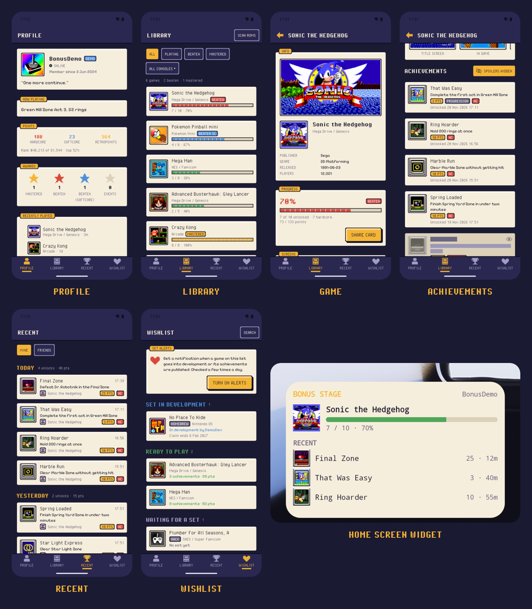
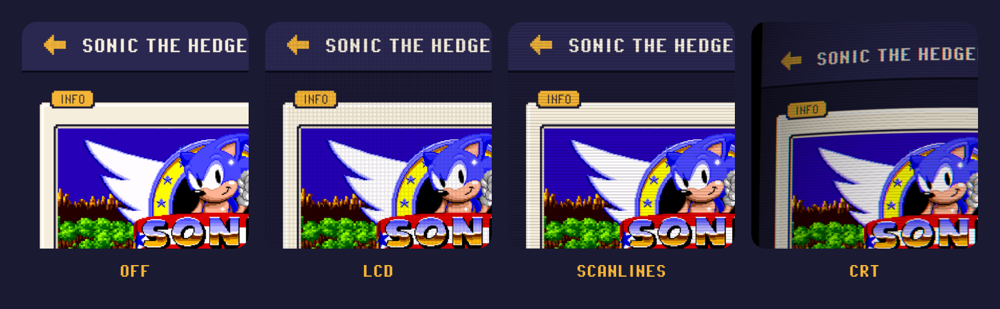

<h1 align="center">Bonus Stage</h1>

An unofficial companion app for [RetroAchievements](https://retroachievements.org), built with Kotlin Multiplatform and Compose Multiplatform. One shared codebase for Android and iOS.

## What it does

- Sign in with your RetroAchievements username and web API key (stored encrypted on the device), or look around with a built-in demo profile
- Profile with points, rank, awards and recently played games
- Library with completion progress, filters by status and console
- Game detail with title screen, screenshots, achievements and a spoiler filter
- Recent unlocks, yours and your friends'
- Wishlist synced with your "Want to Play" list, with game search and a notification when a set goes into development or gets published
- Friends list, ROM folder scan (rcheevos hashes matched to the catalog), share cards and a monthly recap
- Home screen widget on Android
- Works offline from a local cache, refreshed in the background

All of it wrapped in a retro look: pixel fonts, screens styled after the menus of classic games, optional LCD, scanline and CRT effects.

## Screen effects

Optional effects in the profile options, drawn with a shader on top of the whole app: an LCD pixel grid, scanlines, and a CRT with curvature, colour fringing and vignette. They are off by default.

## Download

Android builds are attached to each [GitHub release](../../releases). iOS needs a build from Xcode for now (see [CONTRIBUTING](CONTRIBUTING.md)).

## Tech stack

- Kotlin Multiplatform, Compose Multiplatform for the shared UI
- Ktor and kotlinx.serialization for the RetroAchievements Web API
- SQLDelight for the local cache
- WorkManager (Android) and BGTaskScheduler (iOS) for background checks

The architecture and the decisions behind it are in [docs/plan.md](docs/plan.md) (Italian) and [docs/adr/](docs/adr/). To build it or contribute, see [CONTRIBUTING.md](CONTRIBUTING.md).

## Disclaimer

Bonus Stage is a fan project. It is not affiliated with or endorsed by RetroAchievements. It uses the public [RetroAchievements Web API](https://api-docs.retroachievements.org/) with each user's own API key, and does not use the RetroAchievements name or logo as its own. Game art and badges are loaded from RetroAchievements and belong to their owners.

## License

[MIT](LICENSE). Third-party fonts, assets and code, with their licenses, are listed in [docs/assets.md](docs/assets.md).
