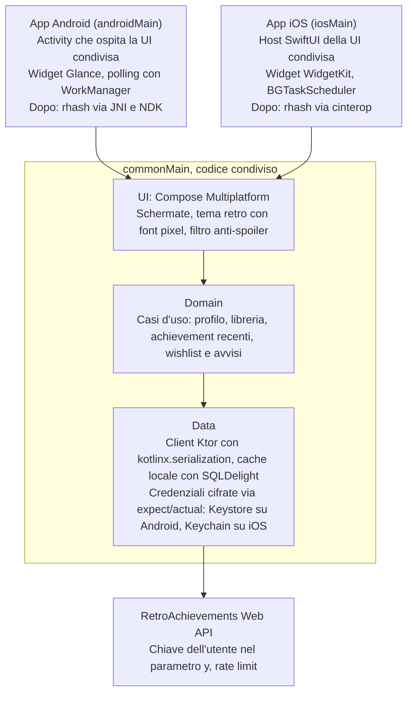

# Bonus Stage: piano del progetto

Esportato dal doc di analisi del 17 novembre 2026. Le decisioni successive vanno registrate in `docs/adr/`.

## Stato attuale

Non risulta un'app ufficiale: RetroAchievements si usa dal sito e dagli emulatori. Le app non ufficiali sono quasi tutte per iOS, mentre Android è di fatto scoperto.

| App | Piattaforma | Note |
| --- | --- | --- |
| [RA Tracker](https://apps.apple.com/us/app/ra-tracker/id6456223916) | iOS | La più curata: backlog, ricerca per console, follow di altri utenti, RANews |
| [Retro Joy](https://apps.apple.com/us/app/id1623005852) | iOS | Gratuita, collezioni personali; aggiornata più volte per cambi dell'API |
| [RetroAchievementsUI](https://appshunter.io/ios/app/retroachievementsui/id6504225426) | iOS | SwiftUI, supporta anche Wii |
| [Retro Achievements (Akissame)](https://appgoblin.info/apps/com.akissame.retroachievements) | Android, iOS | Circa 24K installazioni su Android, 2,71★ su 258 recensioni, pubblicità e acquisti in-app; stima AppGoblin circa 1,6K utenti attivi al mese |

Il pubblico cresce: a gennaio 2026 RetroAchievements ha superato 1 milione di membri registrati ([fonte](https://tech-insider.org/?p=19536)).

## Perché ha senso come progetto

- **API ufficiale e stabile:** nessun rischio legale come con PSN e Xbox.
- **Perimetro piccolo:** un MVP si fa in poche settimane.
- **Spazio libero dove serve:** la concorrenza è debole proprio su Android, e la community retro apprezza l'open source.
- **Base per il progetto grande:** il modulo RA può diventare il primo connettore di un aggregatore multi-piattaforma.

## Limiti da conoscere

- **Niente notifiche in tempo reale degli sblocchi.** Lo sviluppatore di RA Tracker spiega che non sono possibili per come è progettato RetroAchievements ([fonte](https://apps.apple.com/us/app/ra-tracker/id6456223916)). Si possono approssimare con un polling periodico in background, con i limiti di batteria e di frequenza delle richieste.
- **L'API cambia.** Retro Joy ha dovuto rilasciare aggiornamenti per stare al passo ([fonte](https://apps.apple.com/np/app/retro-joy/id1623005852)).
- **Monetizzazione quasi nulla.** Va visto come progetto open source o di portfolio, non come business.
- **Termini d'uso.** Prima di pubblicità o abbonamenti, verificare i termini dell'API e parlarne con il team RA.

## Come distinguersi

1. **Android per primo, iOS subito dopo:** Compose, stile retro ispirato a PokeDaisy: font pixel (Pixel Operator per l'interfaccia, Atkinson Hyperlegible per i testi lunghi), schermate nello stile dei menu dei giochi d'epoca, effetti LCD, scanline e CRT opzionali. Widget per la home con progressi e achievement recenti nello stesso stile. Kotlin Multiplatform fin da subito, con Compose Multiplatform per la UI: logica, client API e schermate condivisi, così la versione iOS arriva poco dopo quella Android.
2. **Wishlist "avvisami quando arriva il set":** un gioco senza achievement viene segnalato quando riceve un set.
3. **Card condivisibili** per mastery e beaten, e riepiloghi mensili.
4. **Feed degli amici, filtro anti-spoiler e backlog per console**, per filtrare i giochi in base ai dispositivi posseduti.

## API RetroAchievements

L'API copre tutto ciò che serve all'MVP, wishlist compresa. Ogni utente però deve inserire nell'app il proprio username e la propria web API key.

- **Autenticazione:** ogni chiamata richiede la web API key nel parametro `y`. La chiave si copia dalla sezione "Keys" del pannello di controllo e va trattata come una password ([getting started](https://api-docs.retroachievements.org/getting-started.html)). Va quindi salvata in modo cifrato (Keystore su Android, Keychain su iOS).
- **Limiti:** il rate limiting è attivo ma senza numeri pubblicati. La documentazione chiede di mettere in cache i dati e, per limiti più alti, di scrivere sul canale #coders del Discord RA ([docs](https://api-docs.retroachievements.org/)).
- **Stabilità:** possono arrivare breaking change, e adeguarsi tocca a chi usa l'API.
- **Termini d'uso:** la documentazione non parla di uso commerciale. Da chiarire con il team RA prima di pubblicità o abbonamenti.
- **Identificativi:** gli username possono cambiare, quindi conviene salvare il ULID dell'utente.
- **Client esistenti:** [api-kotlin](https://github.com/RetroAchievements/api-kotlin) è ufficiale e MIT ma solo JVM, con ultimo push a luglio 2025. Per KMP conviene un client proprio con Ktor e kotlinx.serialization in `commonMain`, usando api-kotlin e [api-js](https://github.com/RetroAchievements/api-js) come riferimento per i modelli.

### Cache locale (decisione, ADR 0002)

Si parte con una cache solo nell'app, in SQLDelight, senza backend. Ogni utente chiama l'API con la propria chiave, quindi il carico resta distribuito. Un backend con cache condivisa si valuta solo quando gli utenti saranno molti.

| Dati | Aggiornamento (valori iniziali, da tarare) |
| --- | --- |
| Console e catalogo giochi | Una volta a settimana, o a richiesta |
| Profilo, punti e badge | All'apertura, se l'ultimo aggiornamento ha più di 15 minuti |
| Progressi e dettaglio gioco | All'apertura della schermata, più pull-to-refresh |
| Achievement recenti e widget | Con il polling in background |
| Wishlist e claim attivi | Con il polling in background, qualche volta al giorno |

L'app mostra sempre prima i dati in cache e li aggiorna dopo, così funziona anche offline.

### Monitoraggio dell'API (decisione, ADR 0003)

Un workflow GitHub Actions pianificato ogni giorno verifica che l'API non sia cambiata e avvisa in caso di breaking change.

1. Chiama ogni endpoint usato dall'app con un account RA dedicato. La chiave sta nei secret del repository.
2. Deserializza le risposte con gli stessi modelli kotlinx.serialization dell'app, in modalità rigorosa: un campo mancante o di tipo diverso fa fallire il job (breaking change).
3. Confronta le risposte con uno snapshot dello schema salvato nel repository: i campi nuovi producono solo un avviso, perché non rompono l'app.
4. Controlla i nuovi commit su [api-docs](https://github.com/RetroAchievements/api-docs), per vedere i cambi annunciati prima che arrivino.
5. Se il job fallisce, apre automaticamente una issue con il diff; la notifica arriva dalla issue stessa.

Una dozzina di chiamate al giorno pesa poco sul rate limit.

### Endpoint per funzione

| Funzione dell'app | Endpoint | Note |
| --- | --- | --- |
| Profilo e punti | `API_GetUserProfile`, `API_GetUserSummary` | Base della schermata profilo |
| Libreria e progressi | `API_GetUserCompletionProgress`, `API_GetGameInfoAndUserProgress` | Completamento per gioco, mastery e beaten |
| Achievement recenti e widget | `API_GetUserRecentAchievements` | Finestra in minuti, default 60: è il punto di partenza del polling |
| Wishlist | `API_GetUserWantToPlayList` | Legge la lista "Want to Play" del sito; visibile solo per sé o tra utenti che si seguono a vicenda |
| Avviso "set in arrivo" | `API_GetActiveClaims` | Claim attivi (max 1000), con `GameID` e `MinutesLeft` |
| Avviso "set pubblicato" | `API_GetUserWantToPlayList` | Il campo `AchievementsPublished` passa da 0 a un valore positivo |
| Feed amici | `API_GetUsersIFollow` + `API_GetUserRecentAchievements` | Lista dei seguiti, poi achievement recenti per ciascuno |
| Badge e card condivisibili | `API_GetUserAwards` | Mastery, beaten ed eventi |
| Catalogo per console | `API_GetConsoleIDs`, `API_GetGameList` | Da tenere in cache: cambia raramente |
| Achievement of the Week | `API_GetAchievementOfTheWeek` | Notifica settimanale, come fa RA Tracker |

## rcheevos

Per l'MVP rcheevos non serve. Diventa utile dopo, per una funzione di scansione delle ROM che dice quali giochi della propria collezione hanno achievement.

[rcheevos](https://github.com/RetroAchievements/rcheevos) è una libreria C, con licenza MIT, pensata per gli emulatori. Non fa richieste HTTP: è il client a scaricare i dati e passarglieli.

| Componente | Cosa fa | Serve all'app? |
| --- | --- | --- |
| rc_client | Gestisce la sessione di un gioco in esecuzione: utente, caricamento del gioco, lista achievement | No: è per gli emulatori |
| rapi | Costruisce gli URL dei servizi web, senza inviare richieste | No: il client Ktor fa già lo stesso lavoro |
| rhash | Calcola l'hash RetroAchievements di un gioco da file o da memoria, anche da ZIP e CHD | Sì, per la scansione delle ROM |

**Integrazione con KMP.** Su iOS rhash si collega con cinterop di Kotlin/Native. Su Android invece Kotlin gira sulla JVM, quindi serve un bridge JNI con l'NDK. Sono due integrazioni native distinte dietro un'unica interfaccia `expect`/`actual`.

**Scansione delle ROM.** L'app calcola gli hash dei file locali e li confronta con quelli del catalogo (`API_GetGameHashes` o la lista completa di giochi e hash).

## Perimetro dell'MVP

L'MVP copre profilo, libreria, achievement recenti e wishlist con avvisi, tutto in sola lettura e con lo stile retro già definitivo. Il resto arriva dopo il primo rilascio Android.

| Funzione | MVP | Motivo |
| --- | --- | --- |
| Login con username e web API key, salvati cifrati | Sì | Requisito di ogni chiamata |
| Profilo, punti e badge | Sì | Prima schermata, base delle card |
| Libreria con progressi per gioco e per console | Sì | Funzione principale |
| Dettaglio gioco con achievement e filtro anti-spoiler | Sì | Molto apprezzato nelle recensioni di RA Tracker |
| Achievement recenti | Sì | Un solo endpoint, alimenta anche il widget |
| Wishlist sincronizzata con "Want to Play" e avvisi su set in lavorazione o pubblicati | Sì | È il tratto distintivo |
| Tema retro: font pixel e palette da menu d'epoca | Sì | Va deciso subito: cambiarlo dopo costa di più |
| Widget per la home (Android) | Dopo | Glance, codice solo Android |
| Feed degli amici | Dopo | Una chiamata per ogni utente seguito: va dosata con il rate limit |
| Card condivisibili | Dopo | Serve prima un tema grafico stabile |
| Effetti LCD, scanline e CRT | Dopo | Shader AGSL su Android e Metal su iOS: due implementazioni |
| Scansione delle ROM con rhash | Dopo | Richiede integrazioni native JNI e cinterop |
| Versione iOS | Dopo, a breve distanza | UI condivisa; restano widget e lavoro in background |

**Polling e notifiche.** Gli avvisi della wishlist si basano su un controllo periodico in background (WorkManager su Android), al massimo qualche volta al giorno, con cache locale per rispettare il rate limit.

## Architettura KMP

Quasi tutto è condiviso: le app native gestiscono solo widget e background.

UI, logica e accesso ai dati stanno in `commonMain`. Le app Android e iOS fanno da host e aggiungono solo widget, lavoro in background e, in seguito, l'integrazione nativa di rhash.
